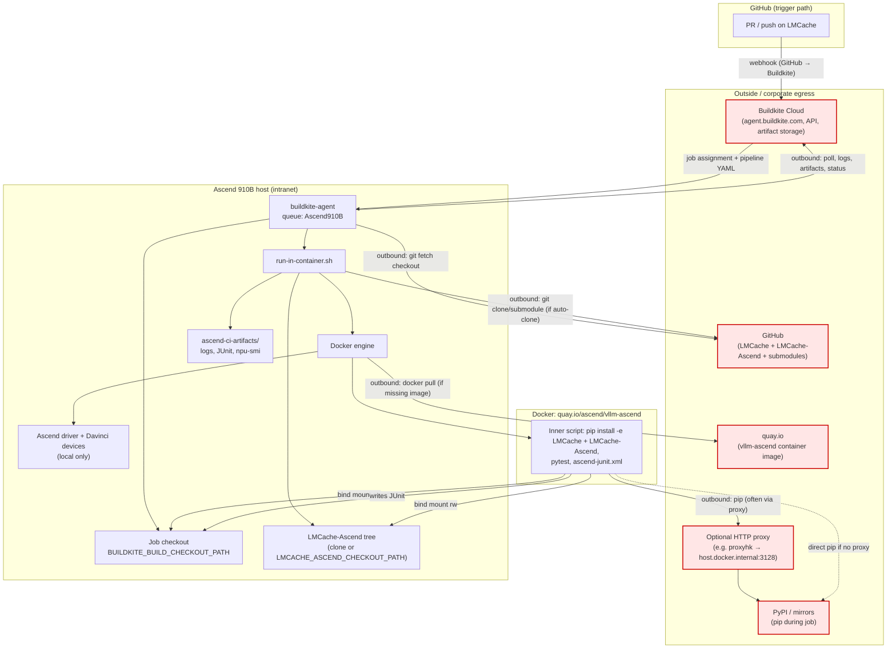
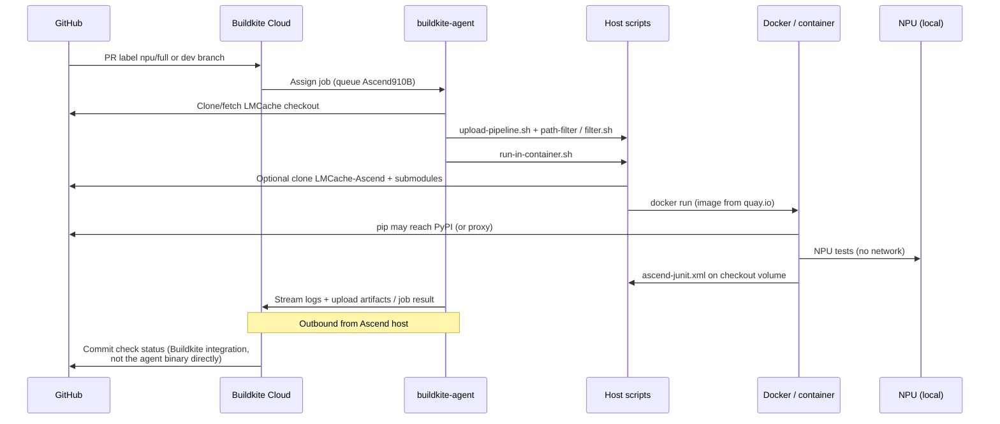

# Ascend 910B Buildkite lane — components and outbound traffic

This lane runs on a **self-hosted** Ascend host. The **Buildkite agent** is the
long-lived controller on that machine: it talks to Buildkite Cloud, prepares the
job checkout, and runs `run-in-container.sh`. It is **not** a receive-only
Jenkins-style controller; **logs, job metadata, and artifacts leave the host**
toward Buildkite (and git/package pulls leave toward the public internet unless
you mirror everything on the intranet).

## Component diagram

## Pipeline steps (logical)

## What leaves the Ascend machine (outbound)

| Source on host | Destination | When | Data |
|----------------|-------------|------|------|
| **buildkite-agent** | **Buildkite Cloud** | Always while registered / during jobs | Job poll, **stdout/stderr log stream**, step annotations, **artifact uploads** (e.g. JUnit, failure logs), agent heartbeat |
| **buildkite-agent** (checkout hook) | **GitHub** | Start of job | **Git** fetch/clone of **LMCache** at build commit |
| **run-in-container.sh** (host `git`) | **GitHub** | If `LMCACHE_ASCEND_CHECKOUT_PATH` unset | **Git** clone/fetch **LMCache-Ascend** + **submodule** updates |
| **Docker** | **quay.io** | First use or `docker pull` | **Container image** layers (`vllm-ascend:v0.26.0rc1`) |
| **Container `pip`** | **PyPI / mirror** | `pip install` test deps + editable installs | **Python packages** (requirements/*.txt); may go via **HTTP proxy** when `proxyhk.huawei.com` resolves |
| **pytest** (optional) | **Buildkite Test Analytics** | Only if `BUILDKITE_ANALYTICS_TOKEN` set | Test timing metadata (plugin present in requirements) |

## What stays on the Ascend host (no intended egress)

| Component | Notes |
|-----------|--------|
| Ascend driver, `npu-smi`, Davinci device I/O | Local kernel / firmware path |
| NPU compute during pytest | On-device |
| `ascend-ci-artifacts/` on disk | Local until agent uploads copies to Buildkite |
| LMCache / LMCache-Ascend source trees | Local bind mounts; only **git/pip** pull content in |

## Controller vs “CI container”

| Role | Process | Outbound? |
|------|---------|-----------|
| **Controller** | `buildkite-agent` on the 910B host | **Yes** — primary egress to Buildkite; triggers checkout from GitHub |
| **Job runner** | `run-in-container.sh` + **Docker** | **Yes** — git clone plugin, image pull, pip; pytest mostly local |
| **Test environment** | Container inner bash | **Mostly no** for NPU work; **yes** for pip (and any test that opens network sockets) |

## Reducing outbound (operator notes)

- Mirror **quay.io** image and set `ASCEND_CI_IMAGE` to an internal registry.
- Pre-populate **`LMCACHE_ASCEND_CHECKOUT_PATH`** and skip auto-clone.
- Use an **internal PyPI mirror** and point `pip` / proxy env at it.
- **Buildkite** still requires agent → cloud connectivity unless you run a self-hosted Buildkite stack (out of scope for this repo layout).
- This lane does **not** run the old intranet-only **Jenkins** `github_status.py` path; status flows **Buildkite → GitHub** when the pipeline is linked to the repo.

See also: [`BK_WEB_SETUP.md`](BK_WEB_SETUP.md), [`run-in-container.sh`](run-in-container.sh).

## Verification PR (fork)

To exercise this lane on a self-hosted **`Ascend910B`** agent:

1. Open a PR into **`dev`** from branch **`ci/test-ascend-trigger`** (or any branch that includes `.buildkite/k3_tests/ascend/`).
2. Add GitHub label **`npu`** (or **`full`**) on the PR.
3. Confirm Buildkite runs pipeline **`lmcache-ascend-910b`** (upload step + Ascend pytest on queue **`Ascend910B`**).
