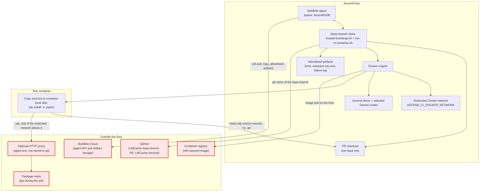

# Ascend 910B Buildkite lane — trust boundary and outbound traffic

This lane runs on a **self-hosted** Ascend host. The **Buildkite agent** talks to
Buildkite, checks out the pull request, and starts Docker. Logs and the
allowlisted artifacts leave the host toward Buildkite. Do not put internal
host names, proxy addresses, or checkout paths in this file or in `pipeline.yml`.

## Trust boundary

Host shell is not taken from the pull request.

1. The Buildkite steps editor runs `buildkite-pipeline.yml`: clone an allowlisted
   base branch (`dev`, `main`, or `master`) and execute `trusted-bootstrap.sh`
   from that clone.
2. The bootstrap uploads `pipeline.yml` from the same clone. Path filtering
   sources `filter.sh` from that clone (`LMCACHE_CI_TRUSTED_ROOT`), not from
   the pull request.
3. The test step clones the base branch again and runs that copy of
   `run-in-container.sh`. The pull request tree is only the code under test.

`dev` / `main` must be protected. A change to these scripts does nothing on the
agent until it is merged, and nothing at all until the steps editor uses the
bootstrap. Leave the old `bash .buildkite/.../upload-pipeline.sh` command in
place and a pull request can still replace the host shell.

## Component diagram

## What leaves the host

| Source | Destination | When | Data |
|--------|-------------|------|------|
| **buildkite-agent** | **Buildkite** | While the agent is registered and during jobs | Job poll, **stdout/stderr**, annotations, **allowlisted artifacts** |
| **git** | **GitHub** | Start of the job, and the trusted clone of the base branch | The pipeline repo. The plugin is not fetched when `LMCACHE_ASCEND_CHECKOUT_PATH` is set |
| **Docker** | **Image registry** | Missing image | The pinned vLLM-Ascend image |
| **Container `pip`** | **Package index** | Install step | Python packages. HTTP proxy only if the agent set `ASCEND_CI_HTTP_PROXY` |
| **pytest** | **Buildkite Test Analytics** | Only if `BUILDKITE_ANALYTICS_TOKEN` is set | Test timing metadata |

`npu-smi info` is part of the log and of `host-npu-smi.txt`. IPv4, IPv6, and
MAC addresses are redacted. The health table, including PCI bus ids, is kept.

## What the container can touch

| Mount or device | Mode |
|-----------------|------|
| Staged LMCache and LMCache-Ascend trees | Read-only. `.git` is not included. The container copies them onto its own disk before `pip install -e` |
| JUnit output directory | Read-write, and the only job directory mounted into the container |
| Ascend driver and DCMI | Read-only. Required for the NPU |
| Davinci nodes listed in `ASCEND_RT_VISIBLE_DEVICES`, plus the manager nodes | Device passthrough |

The container runs as root with `no-new-privileges`. It does not receive
`SYS_PTRACE`. Shared memory is `--shm-size=8g` unless the agent sets
`ASCEND_CI_IPC_HOST=1`. The host CA trust store is not mounted; set
`ASCEND_CI_CA_CERT_FILE` to one file if a proxy intercepts TLS.

## Egress

On Buildkite the script refuses to start the container unless
`ASCEND_CI_DOCKER_NETWORK` names an existing custom Docker network. `host`,
`bridge`, and `none` are rejected. The script cannot install firewall rules.
The agent owner has to create that network and limit its egress (package
index, registry, and the proxy if pip needs one).

`ASCEND_CI_ALLOW_OPEN_EGRESS=1` skips the check. Set it only in the agent
environment, and only when the host has no intranet path worth isolating.
Do not put that opt-out, a proxy URL, or a checkout path in `pipeline.yml`.

Local runs outside Buildkite do not require the network variable, so the same
script can still be used on a development machine.

## Controller vs test container

| Role | Process | Outbound? |
|------|---------|-----------|
| **Controller** | `buildkite-agent` | Yes — Buildkite, and git fetch of the pipeline repo |
| **Trusted host runner** | Base-branch `run-in-container.sh` | Yes — Docker, and a plugin clone only when no pre-provisioned checkout is set |
| **Tests** | Container | Only through the restricted network, for pip |

See also: [`BK_WEB_SETUP.md`](BK_WEB_SETUP.md), [`run-in-container.sh`](run-in-container.sh).
